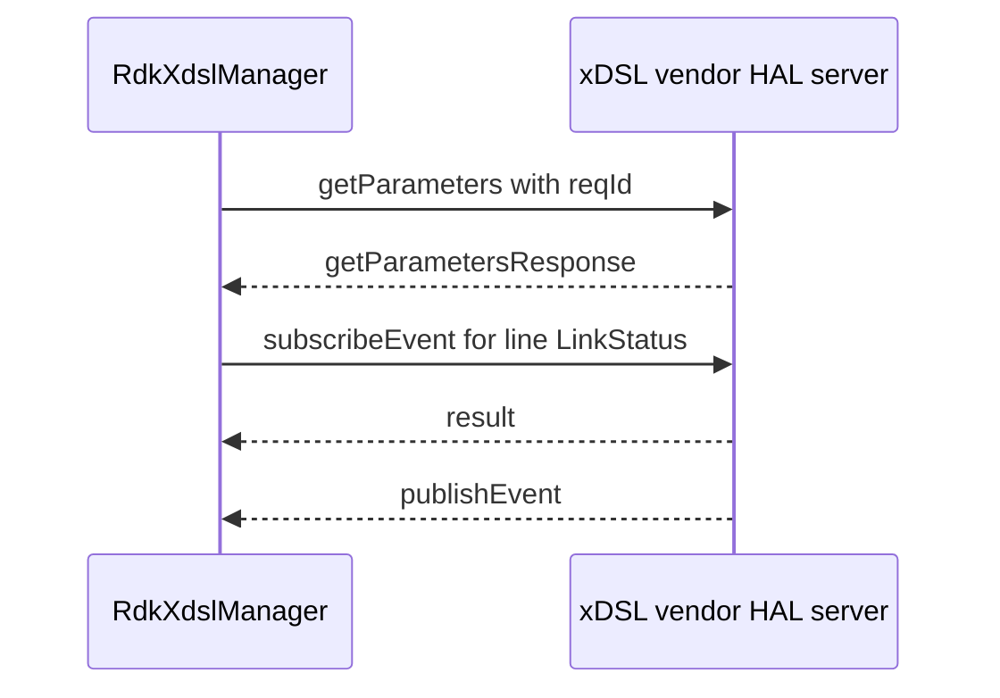

# xDSL JSON HAL Specification

## Version History

| Date | Comment | Version |
| --- | --- | --- |
| — | Documentation alignment; schema unchanged. | — |

## Acronyms

HAL means Hardware Abstraction Layer; DSL means Digital Subscriber Line; ATM means Asynchronous Transfer Mode; PTM means Packet Transfer Mode.

## Description

RdkXdslManager consumes `xdsl_hal_schema.json` for DSL/FAST lines and channels and ATM/PTM link information and configuration. This contract uses module `xdslhal`, version `0.0.1`. Optional facilities depend on the product implementation. See the [detailed protocol reference](halSpecDetailed.md).

## Component Runtime Execution Requirements

### Initialization and Process Model

Start the configured vendor server before RdkXdslManager requests. Product configuration selects `/etc/rdk/schemas/xdsl_hal_schema.json` and port `4098`. Communication uses the shared JSON HAL library over IPv4 TCP.

### Threading and Memory Model

Serialize shared client control and teardown. Manage C-side JSON objects according to json-c ownership rules; copy callback data needed after notification processing.

### Asynchronous Notification Model

Subscribe to the schema's DSL and FAST line `LinkStatus` events. Interpret values using their definitions rather than assuming a complete line-training state machine.

### Blocking Calls

Synchronous library requests wait for a reply or timeout. A timeout does not cancel line training or other remote hardware activity.

### Error Reporting

Check transport/library status separately from wire `Result.Status`. Resolve schema-reference defects before classifying failures as vendor errors.

## Nonfunctional Requirements

### Logging and Debugging

Implementations must not log credentials, secrets, security-sensitive information, or other sensitive data. Log operation outcomes rather than payloads.

### Build and Quality Requirements

Use the product build integration and compatible JSON HAL library. Preflight schema references and examples; establish product-approved restoration before changing line/link configuration or deleting objects.

## Interface API Documentation

The [detailed reference](halSpecDetailed.md) describes all eleven actions, parameter indexes, and event definitions. Determine action eligibility from the schema's supported and optional lists.

## Sequence Diagram

## Source References

- [xDSL schema](https://github.com/rdkcentral/xdsl-manager/blob/main/hal_schema/xdsl_hal_schema.json)
- [Manager configuration](https://github.com/rdkcentral/xdsl-manager/blob/main/config/xdsl_manager_conf.json)
- [Component build identity](https://github.com/rdkcentral/xdsl-manager/blob/main/configure.ac)
